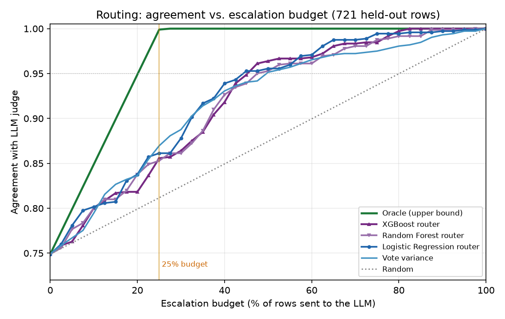

# From Weak Programs to a Router

A follow-up to `IMPROVEMENT_PLAN.md`. It tells the story in three parts: (1) how we found
the weak judge programs and decided what to do, (2) how we acted on those directions, and
(3) the router we learned — with all the accuracy numbers (routing measured at a **25%
escalation budget**) and the escalation plot. The test-CV router is reported **separately at
the end** because it is a ceiling, not a real metric.

All numbers are on the **721-row held-out test set**, scored against the LLM judge's labels.
The committee's base accuracy (no routing) is **0.749**.

---

## 1. Finding the weak programs, and what to do next

We scored all 80 programs individually against both label sets (the 721 LLM-labeled rows and
the 35 human-labeled rows). About 15 of them added little or no signal. Ranked by how well a
program's score separates good from bad matches on the LLM set (AUC; 0.50 = no better than a
coin flip), the **10 weakest** were:

| program | rubric | test AUC |
|---|---|---|
| judge_77 | Modifier/Qualifier | 0.498 |
| judge_34 | Specificity | 0.526 |
| judge_61 | Processing/Additive | 0.528 |
| judge_28 | Nutrition proximity | 0.541 |
| judge_37 | Specificity | 0.544 |
| judge_58 | Processing/Additive | 0.567 |
| judge_74 | Modifier/Qualifier | 0.580 |
| judge_62 | Processing/Additive | 0.585 |
| judge_49 | Food category | 0.587 |
| judge_52 | Food category | 0.592 |

They clustered in a few rubrics (specificity, modifier, processing, food-category), and failed
for three plain reasons: they **assumed the two foods already matched** and only looked for
conflicting words (so they scored almost everything high); they **matched loose single words**
("with", "in") out of context; and some **ranked fine but output on a squashed scale**, so the
single yes/no cutoff threw their signal away.

**The directions we decided to pursue** (from `IMPROVEMENT_PLAN.md`): de-noise the committee,
calibrate the aggregator, **learn a router** to escalate only the uncertain rows, repair the
over-strict programs, and grow the human-labeled set.

---

## 2. Acting on those directions

- **Abstention (make weak programs stay silent).** We let each program abstain when its score
  is near its decision threshold. **Not a clean win** — it destabilized committee selection and
  gave no reliable accuracy gain.
- **De-noise.** Pruning the weakest programs (by a validation-only criterion) left accuracy
  unchanged — they weren't being selected anyway. But replacing the vote-based aggregator with a
  **calibrated continuous aggregator** rescued the "posterior" confidence signal (see below).
- **Routing with the paper's signals.** Escalating the least-confident rows to the LLM works.
  **Vote disagreement** is a usable signal; the **raw Snorkel posterior was poorly calibrated**
  and barely beat random — which the calibrated aggregator fixes.
- **Learn a router.** The main new step — covered next.

---

## 3. Learning a router

**What it is.** A small classifier that looks at a row and predicts **"will the committee get
this one wrong?"** We then spend our LLM budget on the rows it flags as most-likely-wrong.

- **Input:** only committee outputs for the row — every program's score, summary stats, the
  aggregator's confidence, vote disagreement, abstain counts, and simple pair features
  (word overlap, a "hard category" flag). **No LLM call.**
- **Output:** a number = probability the committee is wrong (used to rank rows).
- **Ground truth to train on:** `committee_wrong = 1 if committee's answer ≠ LLM's answer`. We
  generate this honestly on the validation set using 5-fold out-of-fold refits.
- **Training data:** the **222 validation rows** — of which only **22 were committee errors**
  (a small, imbalanced training signal; this matters below).
- **How the budget enters:** the router only *ranks* rows. At serving time we escalate the
  top **X%** most-likely-wrong rows (here **X = 25%**); the rest keep the committee's answer.

### How much data each piece was trained on

The whole system is deliberately data-light. Here is exactly what was trained on what:

| Component | Trained on | Rows | Positive (error) examples | Features |
|---|---|---|---|---|
| The 80 judge programs (synthesis) | 10 few-shot from val | 10 | — | — |
| Committee fit (thresholds, top-k, Snorkel) | val | 222 | — | — |
| Continuous aggregator (a router feature) | val | 222 | — | — |
| Val-trained router (deployable) | val (OOF targets) | 222 | 22 errors | 85 (basic) |
| Test-CV router (ceiling) | test, in 5-fold CV | ~577 per fold (721 total) | 181 errors (~145/fold) | ~97 (enriched) |

**Key points on the router training specifically:**

- **What matters is the number of *error* examples, not rows.** The router learns to spot the
  committee's mistakes, so its training signal is the positives (errors). The deployable router
  saw only **22 errors** in 222 rows; the ceiling saw **~145 per fold**. That ~7× difference in
  error examples — not the model or its hyperparameters — is what separates ~0.86 from ~0.95.
- **The 22 errors are also unrepresentative.** The validation set has a 9.9% error rate versus
  25% on test, because the programs were synthesized from validation few-shot, making validation
  artificially easy. So the deployable router trains on both *too few* and *too easy* errors.
- **This is why tuning didn't help** (XGBoost reached 0.95 cross-validation AUC on val yet still
  needed ~47% escalation on test): you cannot tune your way out of a non-representative, 22-example
  training signal.
- **The fix is data, not modeling:** a few hundred representative, labeled error examples
  (disjoint from the synthesis few-shot) would let the deployable router approach the ceiling.

### Accuracy of every experiment (routing at 25% escalation)

| Group | Method | Accuracy @25% |
|---|---|---|
| Base (no routing) | Programmatic committee | 0.749 |
| Base (no routing) | Continuous calibrated aggregator | 0.750 |
| Routing — baselines | **Oracle** (best possible) | 0.999 |
| Routing — baselines | Random | 0.812 |
| Routing — paper signals | Vote variance | 0.870 |
| Routing — paper signals | Snorkel posterior margin | 0.853 |
| Routing — paper signals | Continuous-aggregator posterior | 0.854 |
| Routing — learned (deployable) | Logistic Regression | 0.861 |
| Routing — learned (deployable) | Random Forest | 0.854 |
| Routing — learned (deployable) | XGBoost | 0.857 |

**Abstention** is on a different axis (it drops weak rows instead of escalating), shown here
with its coverage, not comparable to the 25%-budget rows above:

| band | coverage | accuracy (committed rows) |
|---|---|---|
| 0.00 | 1.000 | 0.749 |
| 0.05 | 0.863 | 0.794 |
| 0.10 | 1.000 | 0.723 |
| 0.15 | 0.943 | 0.740 |

### Escalation plot

**Reading it:** at a 25% budget the deployable routers and paper signals all land around
**0.85–0.87**, well above random (0.81) but well below the oracle (≈1.0). The learned routers
only marginally beat the simple vote-variance signal — because the router had just **22 error
examples** to learn from, drawn from an easy validation set (the programs were built using
validation examples, so validation is not representative of test). **The limit is the training
data, not the model** — hyperparameter tuning of LR and XGBoost changed nothing.

---

## 4. The test-CV router — a ceiling, NOT a real result

To ask *"how good could the router be if it had representative training data?"*, we also trained
it by cross-validation **on the test set itself** (with the richer feature set). This gives:

| Method | Accuracy @25% |
|---|---|
| XGBoost (test-CV, enriched) | **0.949** |
| Logistic Regression (test-CV, enriched) | 0.935 |

**These are not deployable numbers and must not be quoted as results.** They use the **test
labels to train the router**, which you would not have in production. It is a legitimate
*ceiling estimate* (the same way the PAJAMA paper evaluates its ModernBERT router), showing that
**with representative labeled data the router could get close to the oracle (~0.95 at 25%)** — but
the honest, deployable number today is the validation-trained **~0.86 at 25%**. The gap between
0.86 and 0.95 is exactly the value of collecting a representative, labeled router-training set.

---

## 5. Bottom line

- The weak programs are real but pruning them didn't help; the two things that *did* help are
  **calibrated aggregation** (fixes the confidence signal) and **routing** (escalate the
  uncertain rows).
- **Deployable today:** escalate 25% of rows → **~0.86 agreement** with the LLM (≈4× fewer LLM
  calls than grading everything). The best single signal is the learned router / calibrated
  posterior.
- **Biggest lever next:** give the router **representative, labeled training data** (disjoint
  from the program-synthesis examples). That is what moves it from ~0.86 toward the ~0.95
  ceiling — not more model tuning.
