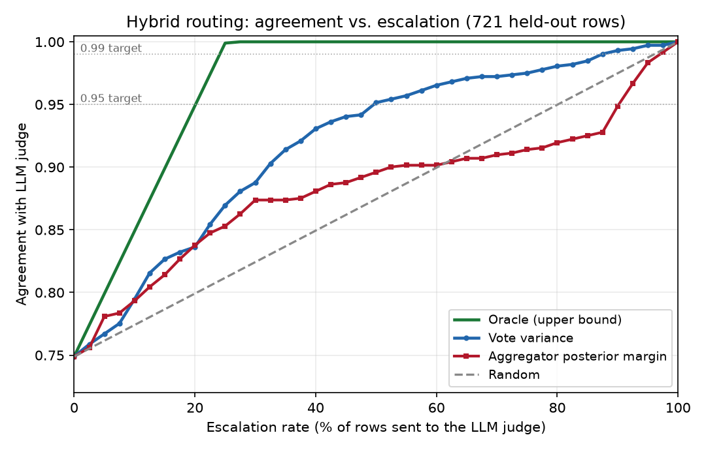

# Abstention and Routing: Experiments and Findings

Two experiments on the substitutability committee, aimed at the deployment target
(**agree with the LLM judge 95–99% of the time while sending as few rows as possible
to the LLM**). All results are on the **721-row held-out test split**; the committee is
fit on the 222-row validation split. Target labels are the LLM judge's `substitutable`
decisions (`gpt-oss-120b`).

---

## 1. Methodology

### Experiment 1 — Abstention (weak-signal dead-zone)
Each program's normalized score is turned into a vote with a **dead-zone of half-width
`band`** around its tuned decision threshold θ: if the score lies in `[θ − band, θ + band]`
the program **abstains** (votes "no opinion") rather than forcing a 0/1. We sweep
`band ∈ {0, 0.05, 0.10, 0.15, 0.20}`, refit the full pipeline (threshold tuning → ≥0.50
filter → top-k selection → Snorkel aggregation) at each band, and report **accuracy on
committed rows** and **coverage** (fraction of rows the committee still decides). This is
the paper's per-program abstention margin (§3.3).

### Experiment 2 — Routing (paper-exact)
On the base committee (`band = 0`) we compute two **deterministic** confidence signals from
the committee output — **no LLM call is used to decide routing**:
- **Aggregator-posterior margin** `|P(substitutable) − 0.5|` (close to 0 = unsure).
- **Vote variance** — disagreement among the selected programs' votes (high = unsure).

We sweep an escalation threshold from 0→100%, routing the least-confident rows first. We
compare both signals against an **oracle** (routes the committee's wrong rows first — the
best-possible policy) and a **random** baseline, and report the escalation rate needed to
reach 0.95 and 0.99 agreement. (The paper's length-based baselines don't apply to short
food strings and are omitted.)

---

## 2. Assumptions (important)

- **Routed rows are counted correct by identity, and no LLM was actually called.** Our eval
  target *is* the LLM judge's label; "escalate" means "ask that same judge," which returns
  the exact stored label. Since the judge runs at temperature 0, re-asking is deterministic,
  so escalated rows agree with the target **by definition** (not by approximation). This is
  why the 100%-escalation endpoint is exactly 1.0.
- **This differs from the PAJAMA paper.** There, the escalation LLM and the ground truth are
  *different*, so their pure-LLM endpoint is the judge's own accuracy (< 1.0) and the hybrid
  can *exceed* it. In our "reproduce-the-LLM-judge" framing the committee can only *approach*
  the LLM, never beat it — which matches the Direct Supply metric ("agree with the LLM").
- **Against human truth the assumption breaks:** an escalated row gets the LLM's answer, which
  is only ~0.91 vs human, so a human-targeted curve would cap at ~0.91.
- Committee base accuracy on test = **0.749** (wrong fraction 0.251); labels precomputed.

---

## 3. Results

### Experiment 1 — Abstention

| band | best_k | coverage | accuracy (committed) |
|---|---|---|---|
| 0.00 | 12 | 1.000 | 0.749 |
| 0.05 | 2 | 0.863 | **0.794** |
| 0.10 | 20 | 1.000 | 0.723 |
| 0.15 | 9 | 0.943 | 0.740 |
| 0.20 | 18 | 0.964 | 0.742 |

**Not a clean win.** The only gain is at `band = 0.05` (0.749 → 0.794 at 86% coverage), and
`best_k` swings erratically (12 → 2 → 20 → 9 → 18). The tell: the dead-zone is applied
*before* threshold tuning, filtering, selection, and Snorkel, so it **destabilizes committee
selection** instead of producing a smooth accuracy-vs-coverage trade. The global dead-zone is
therefore **not a reliable de-noising lever** here.

### Experiment 2 — Routing

| escalation | oracle | vote variance | posterior margin | random |
|---|---|---|---|---|
| 0% | 0.749 | 0.749 | 0.749 | 0.749 |
| 20% | 0.949 | 0.836 | 0.838 | 0.799 |
| 30% | 1.000 | 0.888 | 0.874 | 0.824 |
| 50% | 1.000 | **0.951** | 0.896 | 0.874 |
| 85% | 1.000 | 0.985 | 0.925 | 0.962 |
| 100% | 1.000 | 1.000 | 1.000 | 1.000 |

**Escalation rate needed to hit the target:**

| target | oracle | vote variance | posterior margin | random |
|---|---|---|---|---|
| 0.95 | **22.5%** | **50.0%** | 92.5% | 82.5% |
| 0.99 | 25.0% | 87.5% | 97.5% | 97.5% |

**Findings.**
1. **Routing works; vote variance is the usable signal.** It reaches 0.95 at **~50%**
   escalation vs random's 82.5% — roughly a **2× LLM-cost saving** at the 95% target, with no
   LLM calls to decide routing.
2. **Posterior margin is a poor signal (≈ random).** The Snorkel posterior is **miscalibrated**
   on this noisy committee, so `|P − 0.5|` barely ranks errors — a direct symptom of the weak
   programs identified earlier.
3. **Large oracle gap.** Oracle hits 0.95 at **~22.5%**; the best real signal needs ~50% — i.e.
   the deployable router spends roughly **2× more** LLM calls than theoretically necessary. That
   gap is the core routing research opportunity (RQ2).

---

## 4. Suggestions to improve / reach the target

Ordered by expected payoff toward "95–99% agreement at low escalation":

1. **Learn the router (close the oracle gap — RQ2).** Replace the single-signal threshold with
   a small model (logistic regression / gradient-boosted trees) trained on the validation
   split over the **full committee state** — every program's vote, score magnitude, abstain
   flag, the posterior, and vote variance — to predict "will the committee be wrong here."
   This should move the curve from vote-variance (~50% @ 0.95) toward the oracle (~22.5%),
   still with **zero per-row LLM cost**. Highest-leverage single change.
2. **De-noise the committee first.** Prune the ~3 coin-flip programs (test AUC ≈ 0.5) and feed
   the aggregator **continuous calibrated scores** instead of a single-θ vote. This both raises
   base accuracy (fewer errors to escalate → lower escalation at any target) and should
   **rescue the posterior signal**, which is currently wasted.
3. **Calibrate the aggregator posterior (RQ4).** Fit Platt/isotonic calibration on val so
   `P(substitutable)` is trustworthy; add input-dependent program weighting and correlated-error
   handling (CARE). A calibrated posterior makes margin routing competitive with vote variance,
   and the two can be combined.
4. **Raise base committee accuracy (RQ3 / rubric redesign).** Repair the over-strict
   prep/preservation programs on their failure rows, and give the weak rubrics
   (specificity/modifier/processing) a **core-food-identity backbone**. Every point of base
   accuracy shifts the whole routing curve up, lowering the escalation needed for 95–99%.
5. **Abstention done right.** Drop the global dead-zone (it destabilizes selection). Instead
   abstain **program-internally** ("no opinion when nothing relevant is detected") or apply
   abstention **only at inference** (post-fit), and route the abstained rows — so abstention
   feeds the router rather than fighting the fit.
6. **State the deployable contract now.** Even today the system supports *"escalate 50% → 0.95
   agreement with the LLM"* (≈2× cost saving); closing the oracle gap targets *"escalate ~22%
   → 0.95"* (≈4.4× saving). Report the contract as the headline deliverable.
7. **Grow the human-labeled set.** Needed to confirm that 95–99% agreement-with-the-LLM
   corresponds to acceptable *human* quality, and to unlock the regime where the committee can
   actually **beat** the LLM (only visible against human ground truth).
